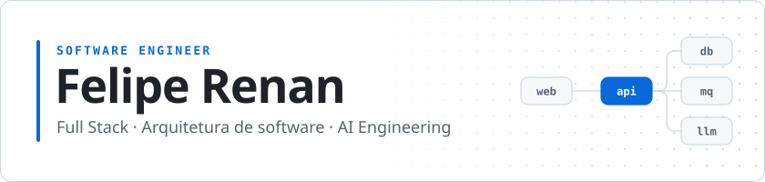
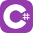

  <picture>
    <source media="(prefers-color-scheme: dark)" srcset="assets/hero-dark.svg">
    <source media="(prefers-color-scheme: light)" srcset="assets/hero-light.svg">
    
  </picture>

  
  &nbsp;
  

Desenvolvedor **Full Stack Pleno**, com atuação em arquitetura de software, APIs e sistemas complexos em produção. Trabalho com **C#/.NET, Node.js, React e TypeScript**, participando de decisões técnicas e da definição de padrões — da modelagem de dados à infraestrutura em nuvem.

Também tenho experiência como **AI Engineer**, construindo **RAG, sistemas multiagentes e integrações via MCP**, da ingestão de dados à orquestração de ferramentas, observabilidade e deploy.

  
  
  
  
  
  
  
  
  
  
  
  
  
  
  
  
  

## Competências técnicas

<table>
  <tr>
    <td width="22%" valign="top"><b>Back-end</b></td>
    <td width="78%" valign="top">
      <code>C#</code> <code>.NET</code> <code>ASP.NET Core</code> <code>EF Core</code> <code>Node.js</code> 
      APIs REST · webhooks · programação assíncrona · autenticação JWT/OAuth
    </td>
  </tr>
  <tr>
    <td valign="top"><b>Front-end</b></td>
    <td valign="top">
      <code>React</code> <code>Next.js</code> <code>TypeScript</code> 
      Interfaces modernas e responsivas, integradas a APIs
    </td>
  </tr>
  <tr>
    <td valign="top"><b>Arquitetura</b></td>
    <td valign="top">
      <code>Clean Architecture</code> <code>SOLID</code> <code>Design Patterns</code> <code>Microsserviços</code> 
      Arquitetura orientada a eventos · definição de padrões · modernização de legado
    </td>
  </tr>
  <tr>
    <td valign="top"><b>Dados &amp; mensageria</b></td>
    <td valign="top">
      <code>PostgreSQL</code> <code>MySQL</code> <code>MongoDB</code> <code>Redis</code> <code>RabbitMQ</code> 
      Modelagem · transações · índices · cache · mensageria · controle de concorrência
    </td>
  </tr>
  <tr>
    <td valign="top"><b>Cloud &amp; DevOps</b></td>
    <td valign="top">
      <code>AWS</code> <code>Docker</code> <code>GitHub Actions</code> <code>Linux</code> 
      CI/CD · infraestrutura · logs · tracing · diagnóstico em produção
    </td>
  </tr>
  <tr>
    <td valign="top"><b>AI Engineering</b></td>
    <td valign="top">
      <code>Python</code> <code>LangGraph</code> <code>LangChain</code> <code>MCP</code> <code>n8n</code> <code>Qdrant</code> <code>Pinecone</code> <code>pgvector</code> 
      RAG · embeddings · busca semântica · sistemas multiagentes · tool calling · memória persistente · observabilidade e deploy de aplicações de IA
    </td>
  </tr>
  <tr>
    <td valign="top"><b>Qualidade &amp; ferramentas</b></td>
    <td valign="top">
      <code>xUnit</code> <code>Playwright</code> <code>Swagger/OpenAPI</code> <code>Postman</code> <code>Git</code> <code>AWS CLI</code> 
      Testes unitários, de integração e E2E · autorização com RBAC · revisão de código
    </td>
  </tr>
</table>

## Experiência profissional

<table>
  <tr>
    <td width="22%" valign="top">
      <b>Devallus</b> 
      mar/2026 — atual
    </td>
    <td width="78%" valign="top">
      <b>Desenvolvedor Full Stack Pleno</b>
      <ul>
        <li>Decisões de arquitetura, definição de padrões e evolução de aplicações <b>multiempresa</b>, com APIs, webhooks e integrações entre serviços.</li>
        <li>Diagnóstico de <b>performance e concorrência</b>, integridade transacional, testes e modernização de código legado.</li>
        <li>Infraestrutura <b>AWS/VPS</b>, <b>Docker</b> e pipelines de <b>CI/CD</b>.</li>
      </ul>
    </td>
  </tr>
  <tr>
    <td valign="top">
      <b>Fidelizar+</b> 
      ago/2025 — mar/2026
    </td>
    <td valign="top">
      <b>AI Developer Jr.</b> · AI Engineering
      <ul>
        <li>Pipelines <b>RAG</b> com Python e pgvector: ingestão, chunking, embeddings e recuperação semântica.</li>
        <li>Sistemas multiagentes com <b>LangGraph e MCP</b>; chatbots com memória e tool calling.</li>
        <li>Automações <b>n8n</b>, observabilidade e deploy na <b>AWS</b>.</li>
      </ul>
    </td>
  </tr>
  <tr>
    <td valign="top">
      <b>Gueppardo.NET</b> 
      abr/2024 — ago/2025
    </td>
    <td valign="top">
      <b>Desenvolvedor Full Stack Jr.</b>
      <ul>
        <li><b>C#/.NET, React, EF Core e MySQL</b>: APIs REST, modelagem de dados e evolução de ERP/PDV com Clean Architecture e SOLID.</li>
        <li>Desenvolvimento completo de aplicação <b>Windows Forms</b> para automação de mensagens e integração com serviços externos.</li>
      </ul>
    </td>
  </tr>
  <tr>
    <td valign="top">
      <b>FAPESQ</b> 
      jul/2022 — mar/2023
    </td>
    <td valign="top">
      <b>Innovation Program Scholar</b> · Programa Ouse Criar
      <ul>
        <li>Concepção e prototipação da plataforma web <b>Me Mostra Campina</b>, voltada ao turismo local, com Kanban, Design Thinking e equipe multidisciplinar.</li>
        <li><b>2º lugar estadual</b> na Paraíba e convite para expandir a solução no Parque Tecnológico da Paraíba.</li>
      </ul>
    </td>
  </tr>
</table>

## Formação & idiomas

**Bacharelado em Sistemas de Informação** · UniFacisa · 2023–2027 · em andamento 
**Técnico em Administração e Negócios** · ECIT Dr. Elpídio de Almeida · 2020–2022 
**Idiomas** · Inglês avançado · Espanhol intermediário
